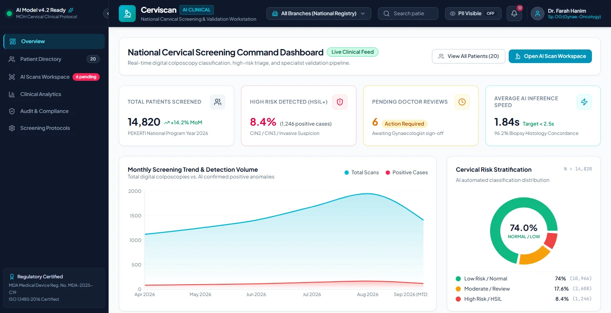
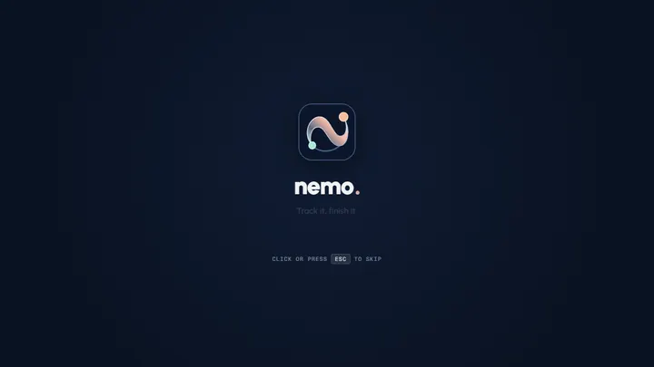
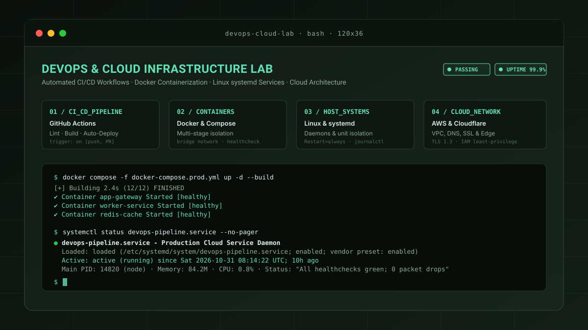
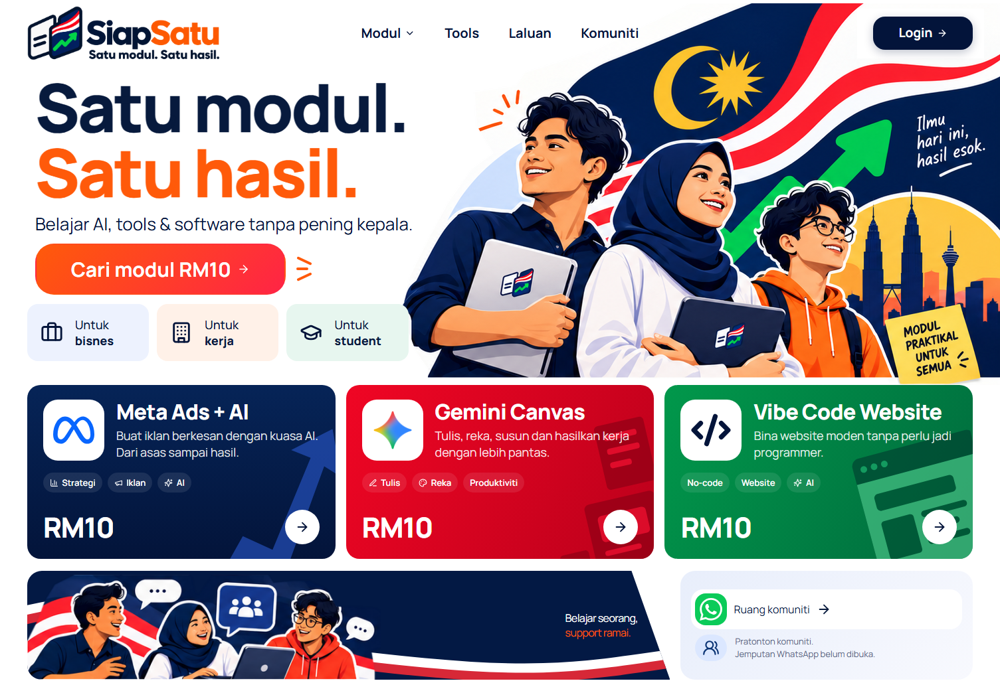
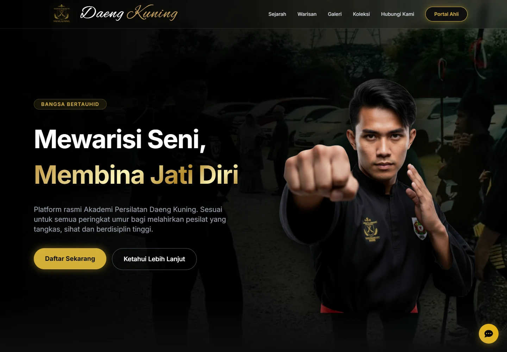
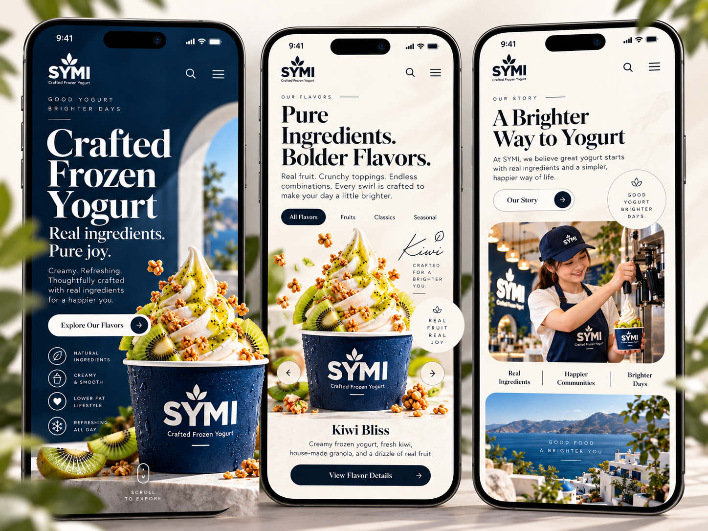

  

  
<strong>Cloud & DevOps Engineer specializing in resilient cloud architecture, CI/CD automation, secure infrastructure, and intelligent edge systems.</strong>

  

    
    
    
    
    
  

## About & Engineering Direction

I engineer high-availability cloud infrastructure, automated CI/CD pipelines, and secure edge-to-cloud systems. With hands-on experience spanning AWS distributed architecture, Linux service orchestration via `systemd`, and Docker containerization, I bridge the entire path from interface design to cloud delivery.

My engineering direction is **Cloud & DevOps Engineering**, backed by national competition recognition in live cloud debugging, international networking credentials, and a strong track record of delivering production-grade web systems for client businesses.

## Key Credentials & Honors

| Credential / Recognition | Scope & Organization | Specialization / Distinction | Verification |
|---|---|---|---|
| 🥈 **Silver Medal** | **NetAcad Riders International 2026** Cisco Networking Academy | APJC International Cisco Networking, Routing & Infrastructure | [View Credential](https://syahmiaof.my/credentials) |
| 🏆 **4th Place & MVP Team Member** | **CloudHunt National Competition 2025** RunCloud Education · IKM Besut | Cloud Architecture, Production Debugging & Infrastructure Defense | [Verify Credential](https://cert.runcloud.education/en/verify/78091311723534?ref=email) |
| 🛡️ **AWS Security Engineer Advanced** | **Amazon Web Services** Coursera Professional Program | Cloud IAM Governance, AWS WAF, Incident Response & Threat Hunting | [Verify Credential](https://coursera.org/verify/professional-cert/N8L3ZOS4U1VN) |
| ☁️ **AWS Cloud Solutions Architect** | **Amazon Web Services** Coursera Professional Certificate | Highly-Available Distributed Architecture, VPC Peering & Storage Security | [Verify Credential](https://coursera.org/verify/professional-cert/N82YX2O4AE7L) |

Also awarded:
- **Silver Medal** — iCompEx International 2026, SMART V-LIGHT (Class D — ICT & Multimedia)
- **Google AI & IT Support Professional Certificates** — Google / Coursera

*These are documented as professional learning programs and competition results, verified with official credentials at [syahmiaof.my/credentials](https://syahmiaof.my/credentials).*

## Cloud, Systems & Edge Engineering

<table>
  <tr>
    <td width="50%" valign="top">
      
      <h3>Greetly</h3>
      
Edge-to-cloud biometric attendance system connecting Raspberry Pi, local OpenCV facial recognition, Supabase realtime backend, and a Next.js admin telemetry dashboard.

      
<a href="https://syahmiaof.my/projects/greetly">Case study</a> · <a href="https://github.com/syahmiaof/greetly">Source</a> · <a href="https://greetly.syahmiaof.my">Live</a>

    </td>
    <td width="50%" valign="top">
      
      <h3>CerviScan-AI</h3>
      
Medical computer vision research platform. Built the real-time video streaming pipeline, CMS telemetry dashboard, and integrated YOLOv8 model inference for assisted sample analysis.

      
<a href="https://github.com/syahmiaof/CerviScan-AI">Source</a> · <a href="https://cerviscan-ai.syahmiaof.my">Prototype</a>

    </td>
  </tr>
  <tr>
    <td width="50%" valign="top">
      
      <h3>NEMO Workspace</h3>
      
Modular personal productivity command hub and developer operating workspace featuring local-first persistence, cloud state synchronization, and quick-access utility tools.

      
<a href="https://github.com/syahmiaof/nemo">Source</a> · <a href="https://nemo.syahmiaof.my">Live</a>

    </td>
    <td width="50%" valign="top">
      
      <h3>DevOps &amp; Cloud Infrastructure Lab</h3>
      
Hands-on cloud infrastructure automation and deployment lab covering multi-stage Docker containerization, automated GitHub Actions CI/CD workflows, and Linux systemd service isolation.

      
<a href="https://github.com/syahmiaof/devops-bootcamp">Source</a> · <a href="https://syahmiaof.my/skills">Architecture Spec</a>

    </td>
  </tr>
</table>

## Selected Web & Interactive Engineering (Freelance Client Work)

<table>
  <tr>
    <td width="50%" valign="top">
      
      <h3>Lamborghini — The Art of Motion</h3>
      
Cinematic automotive scrollytelling web experience featuring Canvas 2D image sequence playback, GSAP ScrollTrigger orchestration, and dramatic Chiaroscuro visual art direction.

      
<a href="https://github.com/syahmiaof/lamborghini-art-of-motion">Source</a> · <a href="https://lamborghini.syahmiaof.my">Live</a>

    </td>
    <td width="50%" valign="top">
      
      <h3>SiapSatu</h3>
      
Interactive Malay-first micro-learning LMS platform built around outcome-based modules, Next.js 14, TypeScript, and high-performance GSAP UI animations.

      
<a href="https://github.com/syahmiaof/siapsatu">Source</a> · <a href="https://siapsatu.syahmiaof.my">Live</a>

    </td>
  </tr>
  <tr>
    <td width="50%" valign="top">
      
      <h3>Daeng Kuning</h3>
      
Production digital portal and web presence for Akademi Persilatan Daeng Kuning, bringing academy heritage, membership registration, and martial arts lineage online.

      
<a href="https://github.com/syahmiaof/daengkuning">Source</a> · <a href="https://daengkuning.my">Live</a>

    </td>
    <td width="50%" valign="top">
      
      <h3>SYMI</h3>
      
High-conversion frontend brand experience with custom editorial art direction, fluid GSAP motion design, and responsive interaction architecture.

      
<a href="https://github.com/syahmiaof/symi">Source</a> · <a href="https://symi.syahmiaof.my">Live</a>

    </td>
  </tr>
</table>

More production &amp; system builds: [Sistem Aduan Asrama (Cloud Native / Firebase)](https://github.com/syahmiaof/sistem-aduan-asrama-ikm) · [GayongX Athlete Analytics](https://github.com/syahmiaof/gayongx-athlete-analytics) · [Jiwa Fighter Combatwear](https://github.com/syahmiaof/jiwa-fighter) · [StatusHD Video PWA](https://github.com/syahmiaof/whatsapp-hd-status-pwa)

## Technical Skills Matrix

| Domain Hierarchy | Core Stack & Technologies | Production Context & Implementation Scope |
|---|---|---|
| **Cloud Platforms** | AWS (EC2, S3, IAM, CloudWatch, VPC, WAF), Cloudflare (DNS, Edge, SSL, Zero Trust), DigitalOcean, Supabase, Vercel | Multi-tier cloud architecture, static/dynamic edge caching, managed database provisioning, secure blob storage, and high-availability global hosting. |
| **DevOps & Tooling** | Linux (Ubuntu, Debian, systemd), Docker & Docker Compose, GitHub Actions, CI/CD Automation, Git, Bash | Automated test/build/deploy pipelines, multi-stage container optimization, background daemon management (`systemd`), and self-healing service workflows. |
| **Networking & Security** | Cisco IOS, DNS Architecture, SSL/TLS Encryption, AWS IAM Least Privilege, AWS Network Firewall, Wireshark | Secure hybrid connectivity, perimeter threat mitigation, zero-trust access policies, packet inspection, domain routing, and automated certificate lifecycle. |
| **Full-Stack & Edge** | TypeScript, Next.js (App Router), React, Node.js, Python, PostgreSQL, OpenCV, Raspberry Pi | Full-cycle client web delivery, micro-learning LMS platforms, interactive WebGL/Canvas interfaces, WebSocket telemetry, and on-device computer vision. |

The complete verified evidence map is available on my [Skills & Tech Stack](https://syahmiaof.my/skills) directory.

## Current Focus & Architecture Principles

- **Resilient Cloud & Systems Foundations:** Prioritizing high availability, minimal attack surfaces, fault tolerance, and predictable disaster recovery.
- **Automated Delivery Pipelines:** Eliminating manual deployment toil with strictly-tested GitHub Actions CI/CD and containerized environments.
- **Edge-to-Cloud Integration:** Bridging low-power edge hardware (Raspberry Pi, OpenCV) with scalable cloud services and realtime monitoring.
- **Client & Business Value:** Delivering tested, production-grade applications with zero broken flows, solid SEO, and measurable user conversion.

  

  <a href="https://syahmiaof.my">syahmiaof.my</a> ·
  <a href="https://github.com/syahmiaof">GitHub</a> ·
  <a href="mailto:hello@syahmiaof.my">Email</a>

